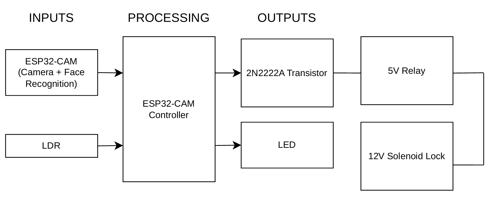

# Face Recognition Door Lock System

An IoT-based door lock prototype that integrates an ESP32-CAM, a cloud-hosted backend, and a face recognition API to control an electronic door lock.

The system captures an image when triggered by a light sensor, sends it to a server for face recognition, and activates a relay when an authorized face is recognized. Recognition results and scan history can also be accessed through a web dashboard.

> **Project type:** Academic project / Proof of concept  
> **Focus areas:** IoT, Embedded Systems, Backend Integration, PCB Design

## 1. Project Overview

This project explores the integration of embedded hardware and cloud services to build a face recognition door access system.

The ESP32-CAM captures images and communicates with a Flask backend hosted on Render. The backend forwards the image to the Face++ API and evaluates the recognition result. When the result meets the configured matching threshold, the ESP32-CAM activates a relay to operate a 12V solenoid lock.

The backend also records recognition events and provides API endpoints for viewing scan history and monitoring system status.

## System Architecture


Additional backend services:
- MongoDB: Recognition history and event metadata
- Supabase Storage: Uploaded image storage
- Web Dashboard: Scan history and system status
```

### Processing Workflow

1. The LDR monitors the surrounding light level and triggers an image capture when the configured condition is met.
2. The ESP32-CAM captures a JPEG image.
3. The firmware uploads the image to the backend through an HTTPS request.
4. The Flask server sends the image to the Face++ recognition API.
5. The backend evaluates the returned recognition confidence against a configured threshold.
6. The server returns a JSON response to the ESP32-CAM.
7. If a match is confirmed, the ESP32-CAM activates the relay for approximately three seconds.
8. The backend records the scan result and related metadata for dashboard display.

## 3. Hardware Components

| Component | Purpose |
|---|---|
| ESP32-CAM (AI Thinker-compatible) | Image capture and Wi-Fi communication |
| LDR | Light-level sensing and capture triggering |
| White LED | Additional illumination |
| I2C LCD 20×4 | Displaying system status and recognition results |
| 5V relay module | Switching the door-lock actuator |
| 2N2222 NPN transistor | Relay-driving circuit component |
| 12V solenoid lock | Physical locking mechanism |
| LM2596S buck converter | Voltage regulation |
| Custom PCB | Hardware integration and interconnection |

The prototype combines sensor input, image capture, network communication, and physical actuation in a single embedded system.

## 4. Software and Technologies

### Embedded Firmware
- Arduino framework
- C/C++
- ESP32-CAM camera driver
- Wi-Fi and HTTP/HTTPS communication
- ArduinoJson
- LiquidCrystal_I2C

### Backend and Cloud Services
- Python
- Flask
- Face++ Face Recognition API
- MongoDB
- Supabase Storage
- Render deployment
- Gunicorn

### Hardware Design and Development Tools
- KiCad for PCB design
- Git and GitHub for version control
- Arduino-compatible development environment

## 5. Key Features

- **Image capture:** Captures images using the ESP32-CAM when the configured LDR condition is met.
- **Cloud-based face recognition:** Uses the Face++ API through a Flask backend.
- **Access control:** Activates the relay when the recognition result satisfies the configured matching threshold.
- **LCD feedback:** Displays system status, recognition results, and error messages.
- **Scan history:** Stores recognition events and associated metadata in MongoDB.
- **Image storage:** Uploads captured images to Supabase Storage.
- **Web dashboard:** Provides scan-history viewing and backend/device status indicators.
- **Capture cooldown:** Uses a configured cooldown interval to reduce repeated capture attempts.

## 6. Experimental Results

The academic project report documented 62 test attempts.

| Test category | Attempts | Successful outcomes | Reported success rate |
|---|---:|---:|---:|
| Authorized-user recognition | 28 | 27 | 96.4% |
| Unauthorized-user rejection | 23 | 20 | 87.0% |
| Combined valid trials | 51 | 47 | 92.2% |

**Interpretation:** The combined 92.2% result applies only to the 51 valid trials. Eleven additional attempts were excluded from this calculation because the system did not detect a face. Therefore, 92.2% should not be interpreted as the success rate across all 62 attempts.

Other observations documented in the report:

- Recognition could be affected by extreme low-light conditions.
- Similar-looking unauthorized individuals caused false acceptances in some trials.
- Severe facial occlusion could cause confusion between registered users.
- Rotated images were recognized less consistently.
- Under favorable network conditions, the reported end-to-end latency was approximately 1.95 seconds.
- Weak network conditions could increase latency substantially.

These results represent tests of an academic prototype, not a production-grade security evaluation.

## 7. Configuration and Deployment

### Backend Environment Variables

Configure the following variables in the deployment environment. Keep actual credentials out of source control.

| Variable | Purpose |
|---|---|
| `FACE_API_KEY` | Face++ API key |
| `FACE_API_SECRET` | Face++ API secret |
| `MONGO_URI` | MongoDB connection string |
| `SUPABASE_URL` | Supabase project URL |
| `SUPABASE_KEY` | Supabase API key |

The backend uses these variables to access the recognition service, database, and image storage.

### Backend Setup

1. Clone the repository.
2. Create and activate a Python virtual environment.
3. Install the dependencies.
4. Configure the required environment variables.
5. Deploy the Flask application using Render or run it locally for development.

Install dependencies with:

```bash
pip install -r requirements.txt
```

Start the application locally with:

```bash
python app.py
```

The actual runtime configuration and credentials must be supplied by the developer. Do not commit `.env` files or API secrets.

### ESP32-CAM Setup

1. Open the firmware source in a compatible Arduino development environment.
2. Configure the Wi-Fi credentials.
3. Configure the backend endpoint.
4. Verify the ESP32-CAM pin assignments and connected hardware.
5. Upload the firmware to the board.
6. Test connectivity and recognition before connecting the actuator to a physical lock.

**Important:** The firmware currently uses `WiFiClientSecure::setInsecure()`, which disables TLS certificate verification. This is a security limitation that should be addressed before any real-world deployment.

## 8. Limitations and Future Improvements

- **Recognition reliability:** Improve handling of similar-looking individuals, occlusion, and failed face detection.
- **Low-light performance:** Improve illumination control and camera exposure.
- **Network resilience:** Add bounded retries, explicit request timeouts on the backend, and clearer recovery behavior.
- **Transport security:** Verify TLS certificates instead of disabling certificate validation.
- **Access-control security:** Add stronger safeguards against unauthorized requests and consider fail-safe actuator behavior.
- **Dashboard reliability:** Improve synchronization between hardware events and dashboard updates.
- **Hardware integration:** Improve enclosure design, wiring protection, and power-management reliability.
- **Testing:** Expand the test dataset and document test conditions, failure cases, and acceptance criteria more systematically.

The current implementation is an educational prototype and should not be used as the sole security mechanism for a real access-controlled facility.

## 9. My Contributions

My work on this project focused on hardware integration, deployment, and system testing.

- Designed the project PCB using KiCad and prepared the design for fabrication.
- Configured the Face++ API credentials and connected the deployed backend to the recognition service.
- Deployed the Flask backend on Render.
- Configured and tested communication between the ESP32-CAM and the cloud backend.
- Tested the recognition-to-relay workflow and investigated integration issues.
- Helped verify the behavior of the integrated prototype through repeated test runs.

The project involved AI-assisted software development. The contribution list above focuses on the hardware, configuration, deployment, and integration work performed rather than claiming sole authorship of all firmware and backend code.

## 10. Repository Structure

```text
server_esp32_cam/
├── app.py
├── requirements.txt
├── train_faceset.py
├── CameraWebServer1/
│   ├── BasicCamera.txt
│   ├── CameraWebServer1.ino
│   ├── app_httpd.cpp
│   ├── board_config.h
│   ├── camera_index.h
│   └── camera_pins.h
├── templates/
│   ├── index.html
│   └── live.html
├── static/
└── report/
    └── CDP301_IC2004_Group2_Report.pdf
```

Some files in the repository are supporting sketches or project materials rather than part of the deployed application's main execution path.

## 11. Acknowledgments

This project integrates third-party services and open-source software, including the ESP32 Arduino ecosystem, Flask, Face++, MongoDB, Supabase, and Render. Each service remains subject to its own license, terms, and usage limits.
